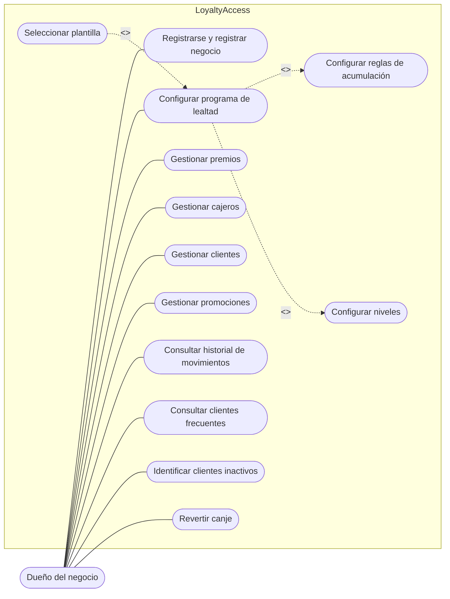
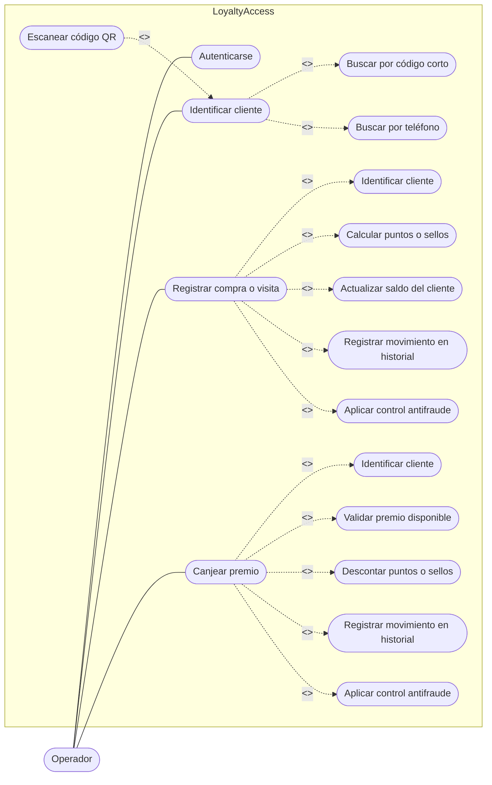
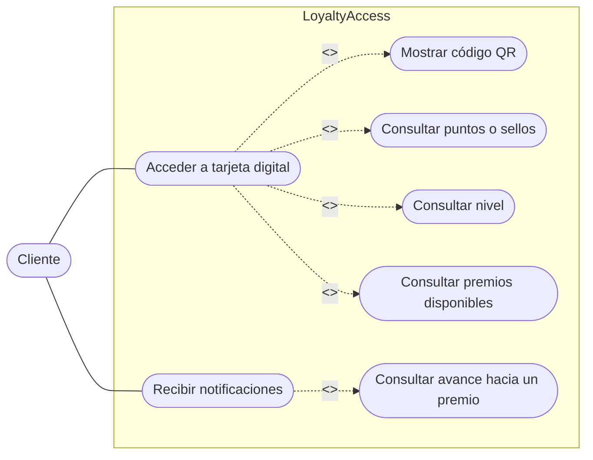
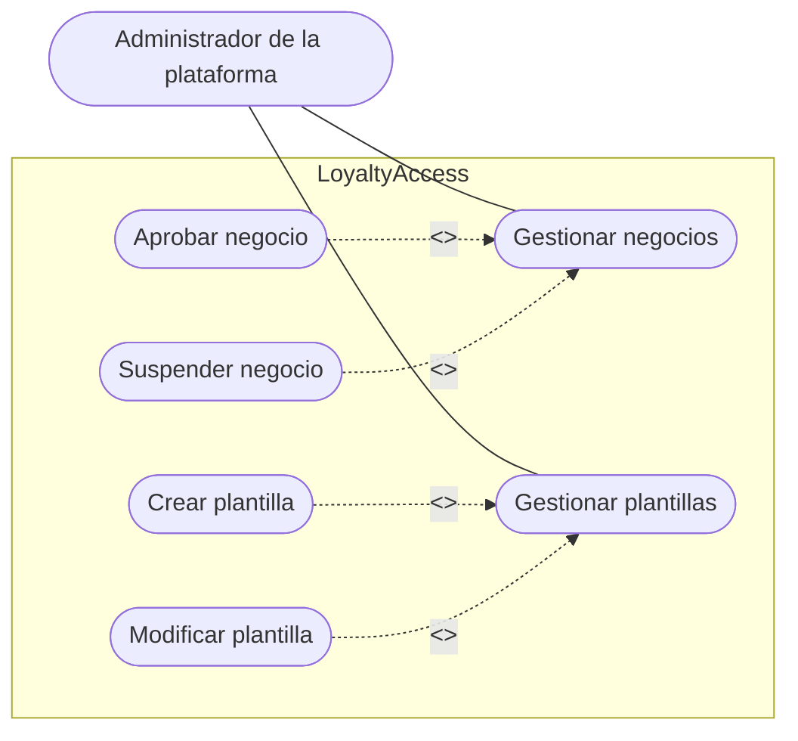

 # Diagramas de Casos de Uso

Los diagramas de casos de uso representan las principales interacciones entre los usuarios y las funciones de LoyaltyAccess.

## Caso de uso: Dueño del negocio

Este diagrama representa las funciones disponibles para el dueño del negocio, como la configuración del programa de lealtad, la gestión de clientes, cajeros, premios y promociones. El dueño también puede revertir un canje fallido o duplicado para devolver los puntos al consumidor. Además, como se explica en la nota del siguiente diagrama, el dueño también puede ejecutar por su cuenta las operaciones de mostrador del diagrama de Operador.

## Caso de uso: Operador (registrar compras y canjes)

Este diagrama muestra las operaciones de mostrador —identificación de clientes, registro de compras o visitas y canje de premios— como funciones del actor genérico **Operador**, del cual heredan tanto el `Cajero` (que se autentica con PIN) como el `Dueño` (que se autentica con su cuenta principal). Así, estas operaciones nunca dependen de que exista un cajero registrado.

> **Nota — el `Cajero` es 100% opcional:** como `Dueño` hereda de `Operador`, puede identificar clientes, registrar compras o visitas y canjear premios desde su propia cuenta principal, sin necesidad de registrar empleados. Por eso LoyaltyAccess está pensado tanto para negocios pequeños —personas que operan solo con su celular y su laptop— como para negocios establecidos que ya cuentan con uno o varios cajeros en mostrador.

## Caso de uso: Cliente

Este diagrama representa la interacción del cliente con su tarjeta digital, permitiéndole consultar sus puntos o sellos, premios disponibles y mostrar su código QR. No se incluye ningún caso de uso de directorio o búsqueda de negocios para el cliente, a fin de respetar el aislamiento de datos entre negocios (RF26).

## Caso de uso: Administrador de la plataforma

Este diagrama muestra las funciones del administrador de LoyaltyAccess, como la gestión de negocios registrados (incluida la suspensión de negocios con actividad sospechosa) y de las plantillas de programas de lealtad.
