# Bitácora de contribución — Segunda entrega

Continuación de la [bitácora de contribución de la primera entrega](bitacora%20de%20contribucionpd1.md). Se usa el mismo criterio de medición para poder comparar ambas entregas.

---

## 1. Equipo y roles

| Integrante | Usuario GitHub | Rol Scrum |
|---|---|---|
| Rodrigo Salazar | `Salazarbru` | Scrum Master |
| Freddy Correa | `FreddyCorreaOjeda` | Product Owner |
| José Correa (Capo) | `capiiim` | Dev team |
| Mauricio Álvarez (Manu) | `Mauricio-AlvarezV` | Dev team |
| Rodrigo Rivera | `riverarodrigo` | Dev team |

## 2. Criterio de medición

Se mantiene el criterio de la primera entrega y se agrega la talla **L** para las tareas de código, que en esta entrega aparecieron por primera vez.

| Talla | Puntos | Ejemplo |
|---|---|---|
| S | 1 | Documento de proceso breve |
| M | 2 | Artefacto o configuración técnica |
| L | 3 | Implementación de código con conexión a base de datos |

- Las competencias otorgan **1 punto a cada integrante**, porque cada quien escribe su propia sección.
- Porcentaje de contribución = puntos del integrante ÷ puntos totales del equipo.
- Los puntos se asignan al responsable del issue en el tablero.

## 3. Distribución de tareas

| Issue | Tarea | Sprint | Talla | Pts | Responsable | Estado |
|---|---|---|---|---|---|---|
| #37 | Cohesión entre artefactos | 1 | M | 2 | Rodrigo Salazar | Done |
| #41 | Integración de Spring Boot | 1 | M | 2 | Rodrigo Salazar | Done |
| #44 | Entidad `Usuario` + Supabase | 1 | L | 3 | Rodrigo Salazar | Done |
| #48 | Criterios de aceptación | 2 | M | 2 | Rodrigo Rivera | Done |
| #49 | Diagrama general de casos de uso | 2 | M | 2 | José Correa | Done |
| #50 | Matriz RF ↔ clases | 2 | M | 2 | Mauricio Álvarez | Done |
| #51 | Resumen de cambios entre entregas | 2 | S | 1 | Freddy Correa | Done |
| #52 | Documentar sprints | 2 | S | 1 | Rodrigo Salazar | Done |
| #53 | Bitácora de reuniones | 2 | S | 1 | Mauricio Álvarez | Done |
| #54 | Métrica de contribución (este documento) | 2 | S | 1 | Rodrigo Salazar | Done |
| #55 | Competencias de la entrega | 2 | S | 1 c/u | Todo el equipo | Done |
| #56 | Video de la entrega | 2 | M | 2 | José Correa | In progress |
| #57 | Presentación de avance | 2 | M | 2 | Freddy Correa | Done |
| #58 | Matriz RNF ↔ diseño | 2 | M | 2 | Freddy Correa | Done |

## 4. Contribución individual — Segunda entrega

| Integrante | Rol | Issues como responsable | Pts por issues | Pts por competencias | Total | % de contribución |
|---|---|---|---|---|---|---|
| Rodrigo Salazar | Scrum Master | #37, #41, #44, #52, #54 | 9 | 1 | **10** | 35.7% |
| Freddy Correa | Product Owner | #51, #57, #58 | 5 | 1 | **6** | 21.4% |
| José Correa | Dev team | #49, #56 | 4 | 1 | **5** | 17.9% |
| Mauricio Álvarez | Dev team | #50, #53 | 3 | 1 | **4** | 14.3% |
| Rodrigo Rivera | Dev team | #48 | 2 | 1 | **3** | 10.7% |
| **Total** | | | **23** | **5** | **28** | **100%** |

## 5. Comparación con la primera entrega

| Integrante | Pts 1.ª entrega | % 1.ª entrega | Pts 2.ª entrega | % 2.ª entrega | Cambio | Pts acumulados | % acumulado |
|---|---|---|---|---|---|---|---|
| Rodrigo Salazar | 4 | 22.2% | 10 | 35.7% | ▲ +13.5 | 14 | 30.4% |
| Freddy Correa | 4 | 22.2% | 6 | 21.4% | ▼ −0.8 | 10 | 21.7% |
| José Correa | 4 | 22.2% | 5 | 17.9% | ▼ −4.3 | 9 | 19.6% |
| Mauricio Álvarez | 3 | 16.7% | 4 | 14.3% | ▼ −2.4 | 7 | 15.2% |
| Rodrigo Rivera | 3 | 16.7% | 3 | 10.7% | ▼ −6.0 | 6 | 13.0% |
| **Total** | **18** | **100%** | **28** | **100%** | | **46** | **100%** |

> El porcentaje acumulado suma 99.9% por redondeo.

```mermaid
xychart-beta
    title "Puntos por integrante en cada entrega"
    x-axis ["Salazar", "Freddy", "José", "Mauricio", "Rivera"]
    y-axis "Puntos" 0 --> 12
    bar [4, 4, 4, 3, 3]
    bar [10, 6, 5, 4, 3]
```

## 6. Observaciones

- El total de puntos subió de 18 a 28 (+56%) porque la entrega incluyó por primera vez trabajo de código.
- La diferencia entre integrantes creció: en la primera entrega era de 1 punto y ahora es de 7. Se debe a que el sprint 1 (cohesión e infraestructura) lo realizó completo el Scrum Master.
- **Acción para la tercera entrega:** repartir las entidades del dominio (`Negocio`, `ProgramaLealtad`, `Cliente`, `TarjetaLealtad`, `Movimiento`) entre los integrantes del equipo de desarrollo para equilibrar la contribución.
- La evidencia de cada tarea está en el issue y en su *pull request* hacia `segunda-entrega`; el detalle por sprint está en [sprints segunda entrega.md](sprints%20segunda%20entrega.md).
